# CampusSwap：基于 AMM 的去中心化交易所与原子套利

> 区块链课程作业 2。本项目基于助教提供的 ZJU-blockchain-course-2026 框架修改，面向本地 Hardhat 测试链，仅用于课程学习和功能演示，不涉及真实资产。

## 1. 项目简介

CampusSwap 是一个简化版 Uniswap V2 风格的去中心化交易所（DEX）DApp。项目包含两种 ERC-20 测试代币、两个独立 AMM 交易所、ERC-721 流动性凭证以及跨交易所原子套利合约。

用户通过 MetaMask 连接本地区块链，可以在网页中领取测试代币、兑换代币、添加和撤销流动性、查询 LP NFT 信息，以及执行跨交易所原子套利。

### 参与角色

- **交易用户（Trader）**：领取测试代币，在 AMM 交易池中完成 Token A / Token B 兑换。
- **流动性提供者（LP）**：向交易池提供两种代币，获得代表流动性仓位的 ERC-721 NFT；撤销流动性时销毁 NFT，并取回对应资产及累计手续费。
- **套利者（Arbitrageur）**：观察 DEX 1 和 DEX 2 的储备比例差异，通过 `AtomicArbitrage` 合约在一笔交易中完成两次兑换。

## 2. 功能与实现分析

### 2.1 ERC-20 测试代币

项目使用 `DemoToken` 部署两种 ERC-20 测试代币：

- Token A（TKA）
- Token B（TKB）

合约提供 `faucet` / `mintTo` 等测试代币铸造接口，方便本地多个账户获取代币并参与交易模拟。

注意：测试铸币接口未设置生产环境所需的严格权限控制，仅用于本地课程测试。

### 2.2 AMM 交易池与兑换

每个 `MiniDEX` 合约可以管理多个交易对。交易池根据排序后的两个 Token 地址计算 `poolId`，并保存储备量、LP 总份额及手续费相关数据。

项目采用恒定乘积做市模型：

\[
x \cdot y = k
\]

交易手续费为 0.30%（30 bps）。输入数量扣除手续费后参与报价：

\[
amountIn_{net}=amountIn \times (1-0.003)
\]

\[
amountOut=
\frac{amountIn_{net}\times reserveOut}
{reserveIn+amountIn_{net}}
\]

手续费保留在池合约中，作为流动性提供者的奖励。储备量按照扣除手续费后的有效输入数量更新，手续费单独记录，避免 LP 领取手续费时重复计算。

### 2.3 添加和撤销流动性、ERC-721 NFT

用户调用 `addLiquidity` 向交易池提供两种代币。

- 首次添加流动性时，根据两种代币数量计算初始 LP 份额。
- 后续添加流动性时，根据交易池储备比例计算实际使用数量和 LP 份额。
- 每次添加流动性都会铸造一枚 ERC-721 NFT，作为该次流动性仓位的凭证。

`positions[tokenId]` 记录 NFT 对应的仓位信息，包括：

- 对应交易池 `poolId`
- LP 份额 `shares`
- 创建时间 `createdAt`
- 手续费增长快照及待领取手续费

每次兑换时，合约根据当时 LP 总份额更新手续费增长数据。

用户撤销流动性时，合约验证 NFT 所有权，结算该 NFT 仓位对应的累计手续费，按照份额取回池中资产，并销毁对应 NFT。

项目使用 `SafeERC20` 和 `nonReentrant` 等机制处理代币转账及重入风险。

### 2.4 多交易所与原子套利（Bonus）

部署脚本会部署两个独立的 `MiniDEX` 实例：

- DEX 1
- DEX 2

两个交易所分别创建 TKA/TKB 交易池并注入初始流动性。随后通过调整 DEX 2 的储备比例制造价格差，为跨交易所套利提供条件。

`AtomicArbitrage.execute` 的主要执行步骤：

1. 从套利者接收 Token B 作为套利本金。
2. 授权 DEX 2，使用 Token B 买入 Token A。
3. 授权 DEX 1，卖出 Token A，换回 Token B。
4. 检查最终 Token B 数量是否达到本金加最低利润 `minProfit`。
5. 满足利润要求后，将 Token B 返还套利者；否则交易执行 `revert`。

整个套利过程在单笔链上交易中原子执行。如果价格差不足或滑点导致利润不满足要求，交易整体回滚，不会留下只完成一边兑换的资产状态。

### 2.5 20 个模拟用户

项目提供 `scripts/simulate.ts` 模拟脚本，使用本地 Hardhat 节点提供的 20 个账户模拟用户操作。

模拟过程中：

- 为模拟账户铸造测试代币。
- 用户分别执行添加流动性操作。
- 随机选择 DEX 1 或 DEX 2 进行代币兑换。
- 使用不同的兑换数量模拟交易行为。
- 部分用户会随机撤销刚创建的 NFT 流动性仓位。

脚本运行结束后，会输出模拟用户操作记录及完成信息。

模拟账户使用本地 Hardhat 预置账户，不需要真实用户私钥。

### 2.6 前端 DApp

前端采用以下技术：

- React
- TypeScript
- Vite
- ethers.js v6
- MetaMask

页面提供以下功能：

- 连接 MetaMask 钱包，显示网络和钱包余额。
- 领取测试代币。
- 查询兑换报价并执行代币兑换。
- 添加流动性并铸造 LP NFT。
- 查询 LP NFT 信息。
- 撤销流动性并销毁 NFT。
- 执行跨 DEX 原子套利。

合约部署完成后，`contracts/scripts/deploy.ts` 会自动更新 `frontend/src/contracts.json`，前端通过该文件读取合约地址。

## 3. 项目目录

```text
amm-dex-project/
├── README.md
│
├── contracts/
│   ├── contracts/          # Solidity 智能合约源码
│   ├── scripts/
│   │   ├── deploy.ts       # 合约部署及交易池初始化
│   │   └── simulate.ts     # 20 个模拟用户操作
│   ├── test/
│   │   └── testMiniDEX.ts  # 合约测试
│   ├── hardhat.config.ts
│   └── package.json
│
└── frontend/
    ├── src/
    │   ├── App.tsx         # DApp 页面及交互
    │   ├── App.css
    │   └── contracts.json  # 部署脚本自动生成
    └── package.json
```

## 4. 环境要求

- Node.js 22.x（助教框架要求 Node.js 22.13+）
- npm
- MetaMask 浏览器插件
- Hardhat 本地区块链节点

## 5. 安装与运行

以下命令以 Windows PowerShell 为例。

### 第一步：安装合约依赖

在项目根目录打开终端：

```powershell
cd contracts
npm install
```

### 第二步：启动本地区块链

在 `contracts` 目录打开一个终端：

```powershell
npm run node
```

Hardhat 节点默认 RPC 地址：

```text
http://127.0.0.1:8545
```

Chain ID：

```text
31337
```

启动后保持该终端运行，不要关闭。

### 第三步：编译、测试和部署合约

在另一个终端中进入 `contracts` 目录，依次执行：

```powershell
npx hardhat compile
npx hardhat test
npm run deploy
```

部署脚本会部署 Token A、Token B、DEX 1、DEX 2 和原子套利合约，并初始化交易池及初始流动性。

部署成功后，终端会输出合约地址，并自动更新：

```text
frontend/src/contracts.json
```

### 第四步：配置 MetaMask

在 MetaMask 中添加本地网络：

| 配置项 | 内容 |
|---|---|
| 网络名称 | Hardhat Local |
| RPC URL | `http://127.0.0.1:8545` |
| Chain ID | `31337` |
| 货币符号 | ETH |

可以导入 Hardhat 节点输出的测试账户，用于本地交易测试。

**注意：Hardhat 默认测试账户的私钥仅用于本地开发，切勿将私钥上传至 GitHub，也不要用于真实资产。**

切换到 Hardhat Local 网络后，打开前端并连接 MetaMask。

### 第五步：启动前端

新开一个终端，在项目根目录执行：

```powershell
cd frontend
npm install
npm run dev
```

前端通常运行在：

```text
http://localhost:3000
```

如果 Vite 终端显示了其他端口，以实际输出为准。

打开网页，连接 MetaMask，即可体验 DApp 功能。

### 第六步：运行 20 个模拟用户

确保 Hardhat 节点仍在运行，并且已经成功部署合约。

打开一个新的 PowerShell 终端，进入 `contracts` 目录：

```powershell
cd contracts
```

将部署输出中的四个合约地址设置为环境变量：

```powershell
$env:TOKEN_A="Token A 合约地址"
$env:TOKEN_B="Token B 合约地址"
$env:DEX1="DEX 1 合约地址"
$env:DEX2="DEX 2 合约地址"
```

然后执行：

```powershell
npm run simulate
```

脚本会使用本地 Hardhat 节点提供的前 20 个账户进行模拟。运行时会显示各账户的操作结果，成功完成后会输出：

```text
Simulation completed for 20 users.
```

注意：

- 上述四个地址必须替换为本次部署实际输出的地址。
- 如果重新启动 Hardhat 节点，需要重新部署合约，并重新设置对应地址。
- 环境变量只在当前 PowerShell 终端会话中有效。
- 运行模拟脚本前，请确保本地节点持续运行。

## 6. 建议演示流程

项目演示可以按照以下顺序进行：

1. 启动 Hardhat 节点，编译、测试并部署合约。
2. 打开前端网页，连接 MetaMask，领取测试代币。
3. 输入 Token A 数量，计算兑换报价并执行兑换。
4. 输入两种代币数量，添加流动性，展示生成的 LP NFT Token ID。
5. 输入 NFT Token ID，撤销流动性，展示 NFT 销毁及资产返还。
6. 展示 DEX 1 和 DEX 2 的储备量差异，执行原子套利。
7. 在终端运行 20 用户模拟脚本，展示模拟账户操作结果。

## 7. ## 7. 项目运行截图与演示视频

以下截图均来自 CampusSwap 项目的实际运行过程，展示了系统的主要功能及执行结果。

### 7.1 MetaMask 钱包连接

展示 MetaMask 成功连接 Hardhat 本地测试网络。（这里的截图是实验做完之后截的图 所以这里的金额和7.2金额对不太上 视频里是从791000到792000的）

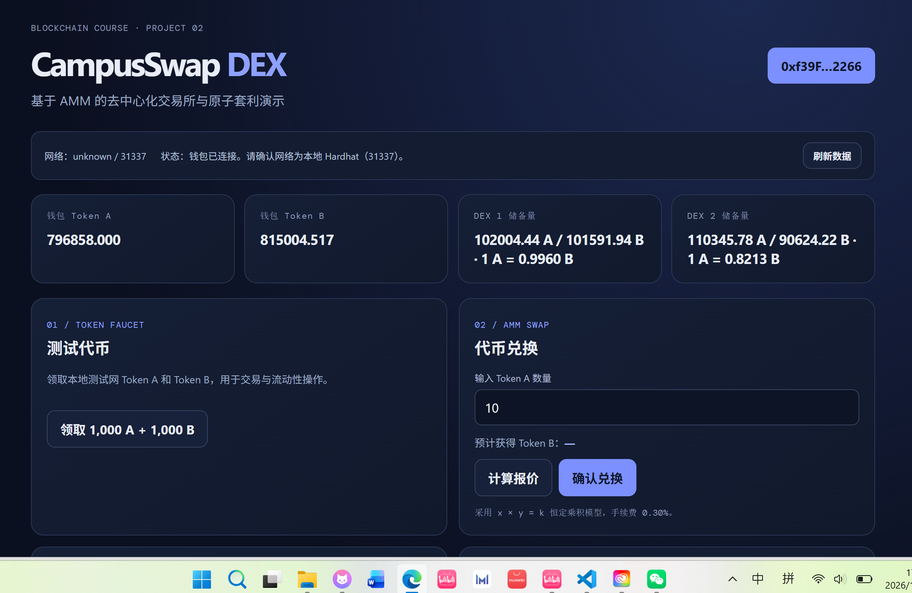

### 7.2 领取测试代币

展示用户领取 Token A、Token B 测试代币及账户余额。

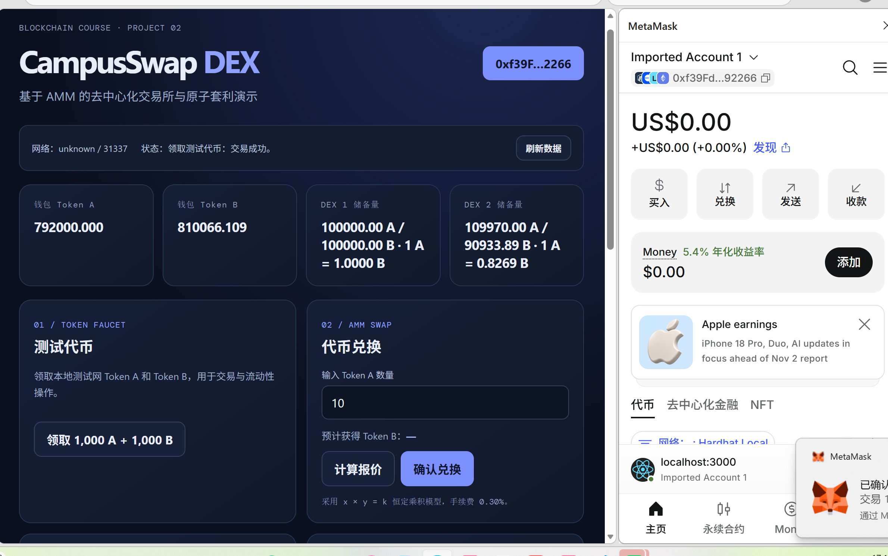

### 7.3 AMM 代币兑换

展示用户输入兑换数量、查询兑换报价，以及执行代币兑换后的结果。

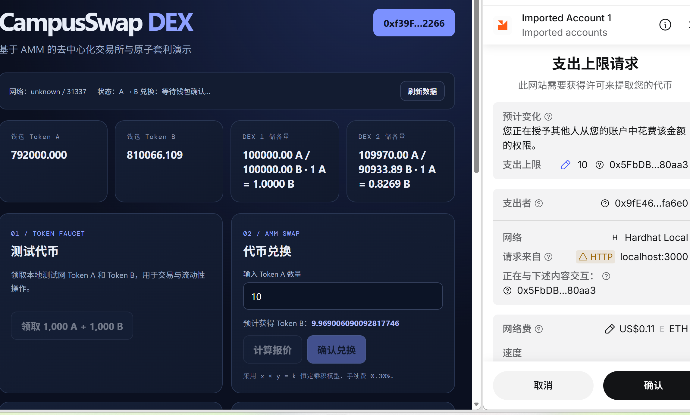

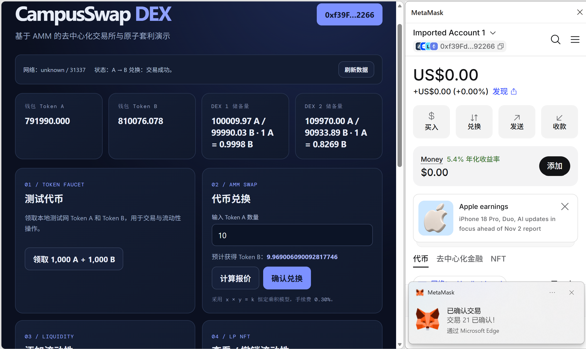

### 7.4 添加流动性与 LP NFT

展示用户向 AMM 交易池添加流动性，以及 ERC-721 LP NFT 铸造和仓位信息。


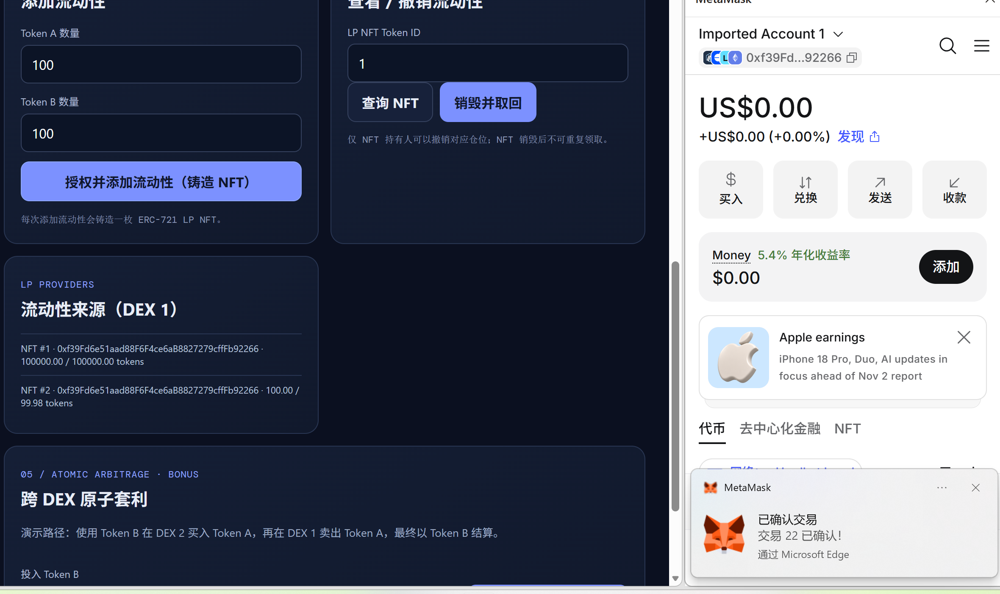

### 7.5 撤销流动性

展示用户查询 LP NFT、撤销流动性、销毁 NFT 并取回对应资产的过程。

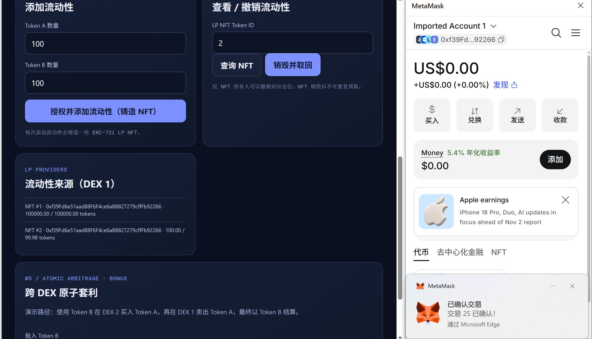

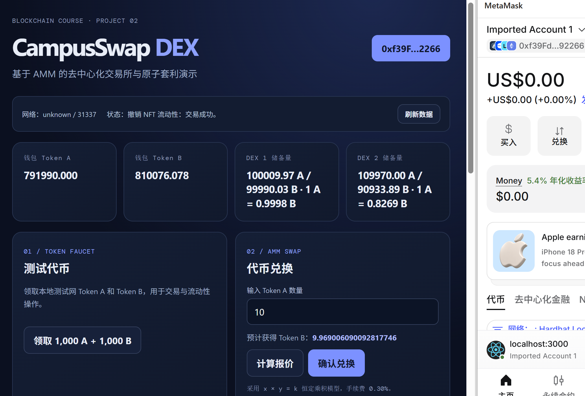

### 7.6 跨交易所原子套利

展示两个独立 AMM 交易所之间的价格差异、原子套利执行过程及最终结果。

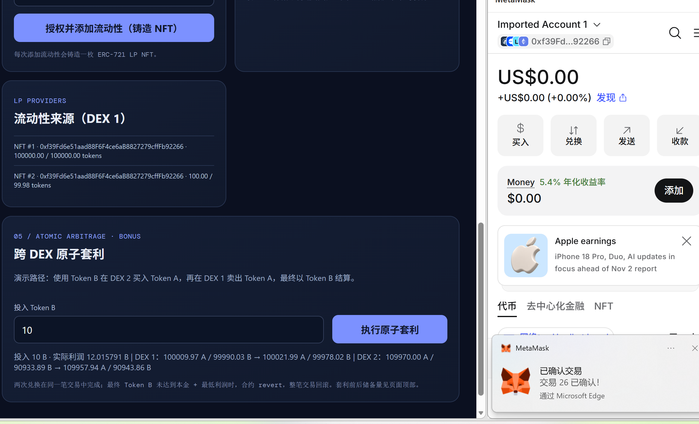

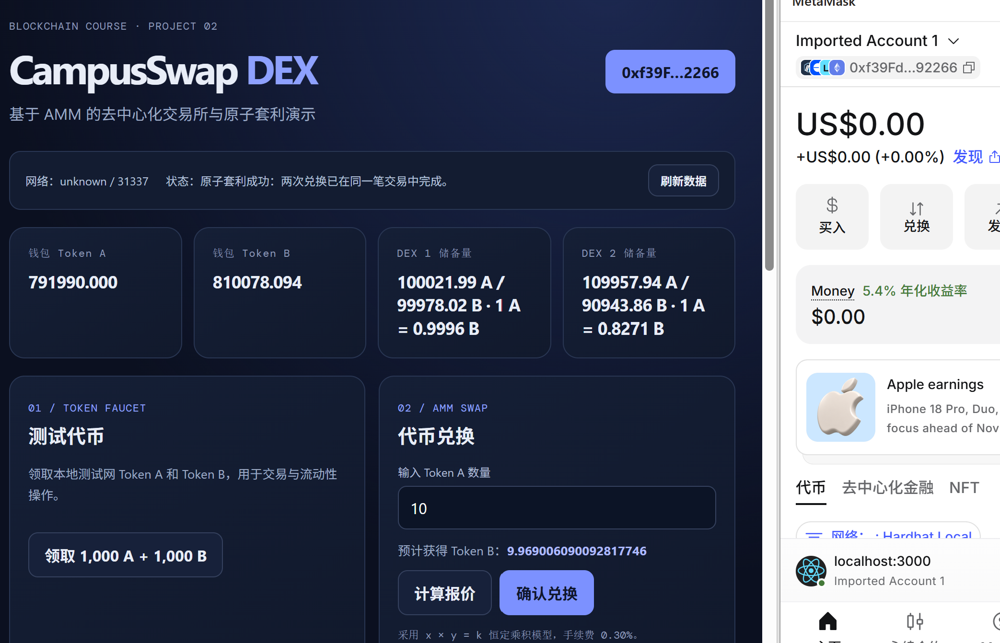

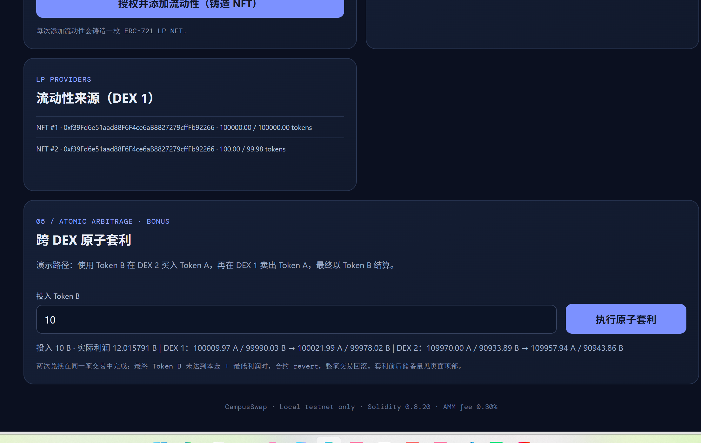

### 7.7 20 个模拟用户

通过模拟脚本运行 20 个本地账户，展示多个用户执行添加流动性、代币兑换及其他模拟操作的结果。

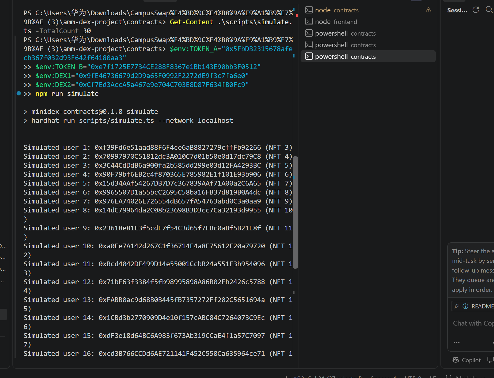

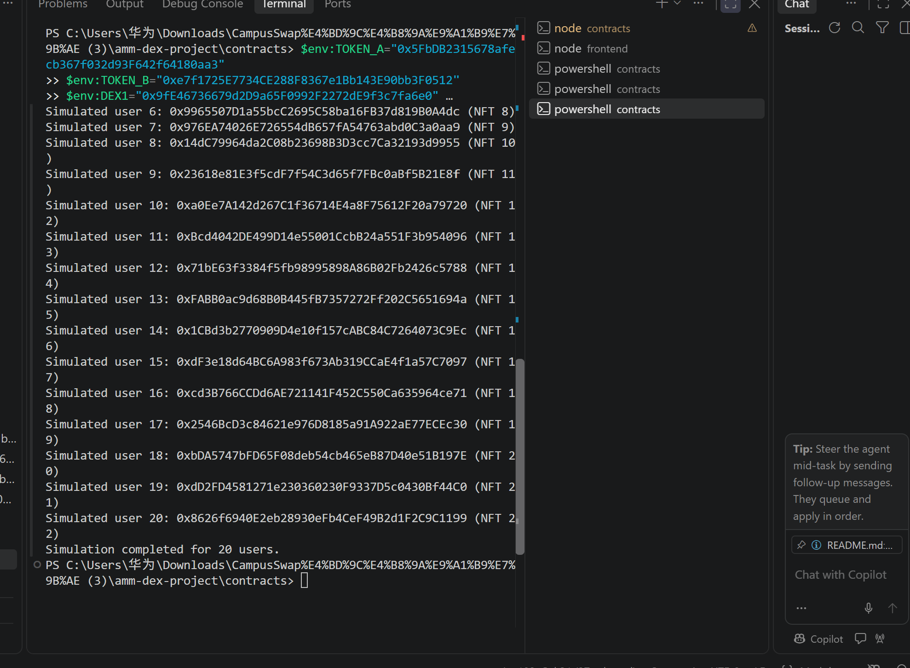

### 7.8 演示视频

项目演示视频展示钱包连接、测试代币领取、AMM 兑换、流动性管理、跨交易所原子套利及 20 个模拟用户操作等主要功能。
项目演示视频展示钱包连接、代币领取、兑换、流动性管理、原子套利及多用户模拟等主要功能。
演示视频建议控制在 1–2 分钟，展示钱包连接、领取代币、兑换、添加和撤销流动性、原子套利及模拟用户运行结果。

所有截图和视频均应来自项目实际运行过程。

## 8. 安全与限制

本项目是区块链课程教学演示，不是生产级 DEX。

目前项目主要用于本地测试，存在以下限制：

- `DemoToken.mintTo` 等测试铸币接口未采用生产环境所需的严格权限控制。
- 未实现预言机、路由聚合、闪电贷和 MEV 防护。
- 未实现复杂的 LP 部分减仓及手续费治理。
- 尚未经过专业智能合约安全审计。

如需用于真实资产交易，应进一步完善权限控制、精度和极端数值处理，进行全面安全审计，并采用经过审计的代币及合约实现。

## 9. 参考资料

- [Uniswap](https://app.uniswap.org/)
- [OpenZeppelin Contracts](https://docs.openzeppelin.com/contracts/)
- [Hardhat](https://hardhat.org/)
- [ethers.js v6](https://docs.ethers.org/v6/)
- [助教课程仓库：ZJU-blockchain-course-2026](https://github.com/LBruyne/ZU-blockchain-course-2026)
